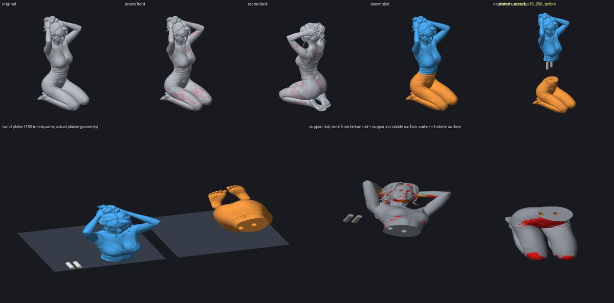
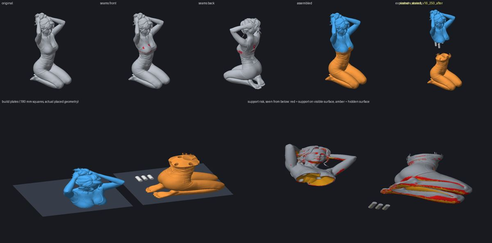
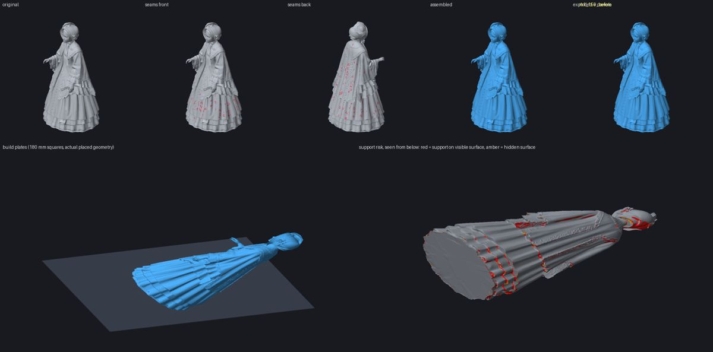
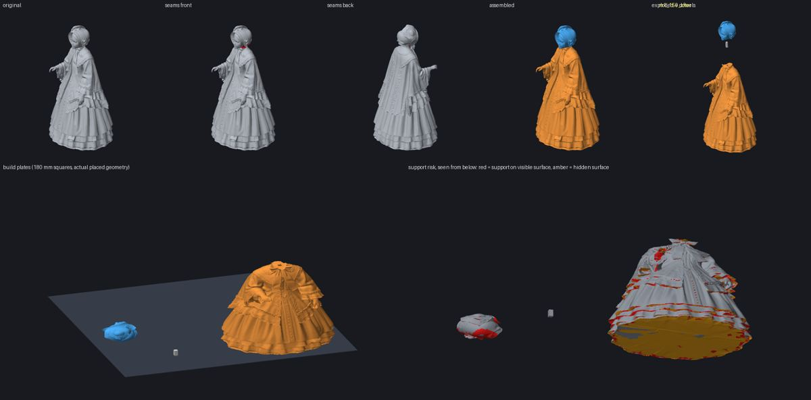
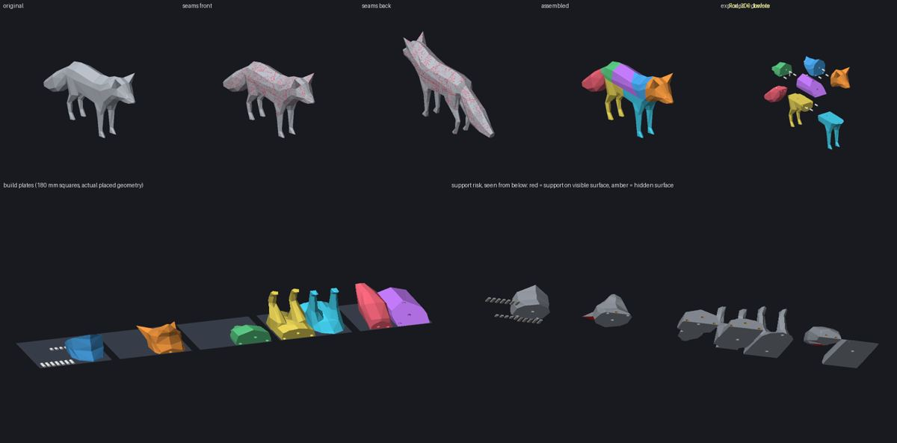
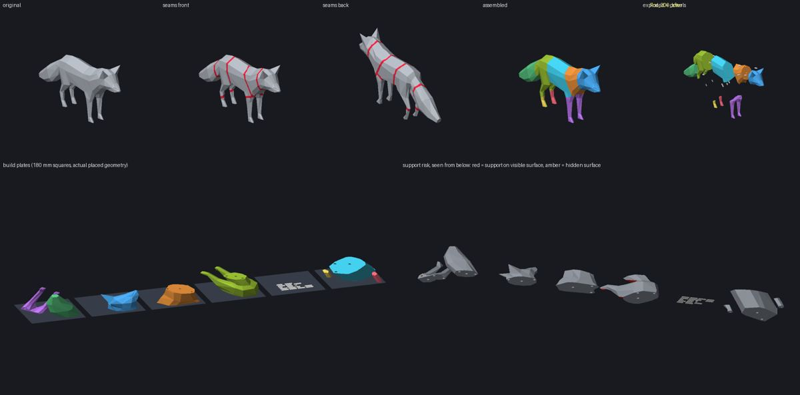
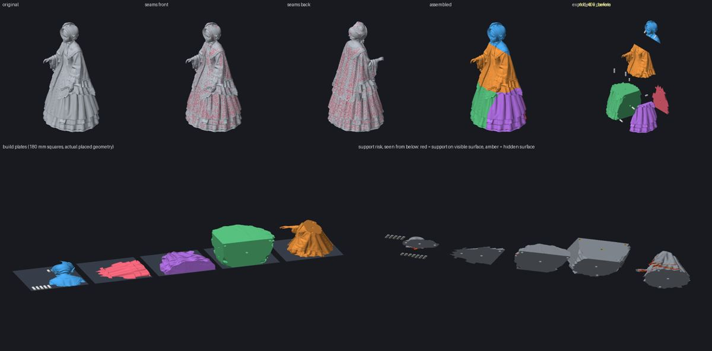
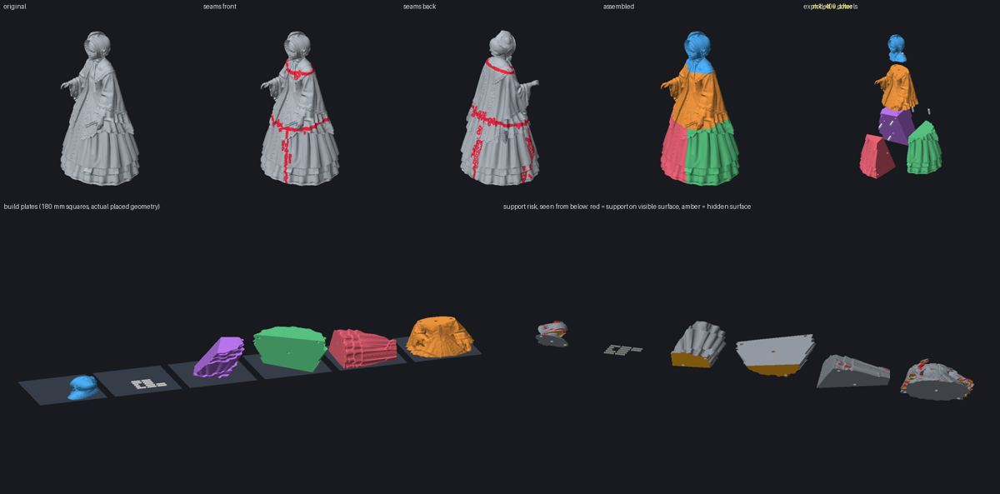

# Auto Prepare redesign: before / after

Same 9 test cases (`models/`), same evaluator for both pipelines (`scripts/report.ts`: one surface-visibility field, one orientation/seam scorer), plus real slicing of every exported project with Bambu Studio 02.09 CLI (`scripts/bbs.ts`, tree supports, A1 Mini 0.4, 0.20 mm Standard, PLA Basic).
Reproduce: `scripts/run-all.sh e2e out/e2e && scripts/run-all.sh bbs out/e2e && scripts/run-all.sh report out/report && scripts/run-all.sh legacy out/report && python3 scripts/summarize.py out/report out/e2e`.

## Diagnosis of the old pipeline
- Split only when the model did not fit; a model that fit was printed whole in any orientation (m1/woman@150 stood on ~0 mm² contact).
- Cut planes ranked by cross-section perimeter only; no notion of which surfaces are visible, hidden under a hem, or detailed.
- Orientation = least >45° overhang area, ignoring *where* supports land (faces, visible ruffles).
- Shelf packing on bounding boxes, dowels on their own plate (Fox@300: 7 parts on 5 plates).
- Export: one generic 3MF per plate, no Bambu project.

## What changed
Surface field (visibility from head-on views, detail, concavity) → candidate planes scored by visibility-weighted seam → beam search jointly scoring cuts + per-part orientation + joints + parts + plates (unsplit always a candidate, extra part must win ≥ 8 %) → curved seams (height-field cutter snapping the seam into a fold/hem within ±12 mm, kept only if ≥ 15 % less visible and topology/fit unchanged) → dowels centred on the (curved) seam, verified in material → shape-aware packing with brim/support room, dowels in one cluster → Bambu Studio project 3MF with plates.

## Results
| Model | parts (before→after) | plates | dowels | seam mm, visibility-weighted | support on visible mm² | support total mm² | min bed contact mm² | curved seams | checks | Bambu Studio slice (after) |
|---|---|---|---|---|---|---|---|---|---|---|
| Fox @150 mm | 2 → 2 | 1 → 2 | 2 → 2 | 165 → 222 | 2784 → 1757 | 3135 → 1758 | 1915 → 2176 | 0/1 | all PASS | OK, 2 plate(s), support 10.4 cm³ of 155.3 cm³ |
| Fox @300 mm | 7 → 8 | 5 → 6 | 17 → 17 | 13887 → 1912 | 3720 → 1261 | 5460 → 3376 | 2023 → 229 | 0/5 | all PASS | OK, 6 plate(s), support 8.3 cm³ of 983.1 cm³ |
| Lantern @250 mm | 5 → 5 | 1 → 1 | 1 → 1 | 2897 → 161 | 514 → 851 | 3398 → 2283 | 0 → 0 | 1/1 | all PASS | OK, 1 plate(s), support 17.8 cm³ of 77.1 cm³ |
| m1 @150 mm | 1 → 2 | 1 → 1 | 0 → 1 | 675 → 41 | 1519 → 1547 | 1472 → 6473 | 0 → 8 | 1/1 | all PASS | OK, 1 plate(s), support 25.9 cm³ of 114.0 cm³ |
| m1 @400 mm | 5 → 5 | 5 → 6 | 12 → 12 | 14461 → 2489 | 3299 → 2567 | 7100 → 21039 | 5696 → 0 | 0/4 | all PASS | OK, 6 plate(s), support 119.2 cm³ of 1563.6 cm³ |
| prototype-kit-animal-bison @250 mm | 3 → 4 | 4 → 5 | 6 → 9 | 1175 → 1295 | 525 → 858 | 20197 → 6089 | 5771 → 13466 | 0/3 | all PASS | OK, 5 plate(s), support 12.2 cm³ of 1358.3 cm³ |
| prototype-kit-figurine @150 mm | 1 → 5 | 1 → 1 | 0 → 0 | 0 → 0 | 275 → 578 | 351 → 459 | 0 → 1310 | 0/0 | all PASS | OK, 1 plate(s), support 2.9 cm³ of 91.2 cm³ |
| woman_seated_v16 @150 mm | 1 → 1 | 1 → 1 | 0 → 0 | 394 → 0 | 4424 → 1704 | 3865 → 4077 | 0 → 26 | 0/0 | all PASS | OK, 1 plate(s), support 27.5 cm³ of 89.7 cm³ |
| woman_seated_v16 @250 mm | 2 → 2 | 2 → 2 | 2 → 3 | 3527 → 361 | 4767 → 4534 | 6407 → 14555 | 23 → 23 | 1/1 | all PASS | OK, 2 plate(s), support 53.3 cm³ of 290.9 cm³ |

Notes on the numbers:
- "Bambu Studio slice" is real slicer output for the new export. Old exports were not Bambu projects (no plates), so no slicer column for "before".
- Support/seam columns are geometric estimates. "Before" seam numbers are inflated for multi-cut legacy results (the cap-adjacency seam metric counts every ancestor plane's slab); treat them as indicative.
- Plate counts went up on Fox/m1@400/bison: the packer now reserves 5 mm brim/support room per part, 5 mm bed margin and a 30 mm keep-out around the dowel cluster, because Bambu Studio rejected tighter layouts (path conflicts, G-code outside bed). The old layouts were never sliced; they would have hit the same errors.
- Total support area rises where an inverted/upright print moves supports onto hidden surfaces (m1 skirt cavity, woman thighs): the optimiser trades hidden support for less support on visible surfaces, by design.

## Images (left: before, right-hand files: after)
Each sheet: original · seams front/back · assembled · exploded with dowels · plates (real placed geometry) · support risk from below (red = visible surface, amber = hidden).

## Known limits
- Curved seams only bend within ±12 mm of a plane (height field); deep spiral/undercut boundaries are out of reach. Accepted on 3 of 9 cases (m1 neck under bonnet, woman under-bust crease, Lantern); low-poly models (Fox, bison) have no folds to snap to.
- The woman figure looks down, so her face gets supports in any upright print (pose-inherent).
- No semantic labels; "face" importance comes from visibility + detail only.
- Joint clearances untested on hardware.
- Runtime 5–75 s per model in node (browser similar, single worker).
